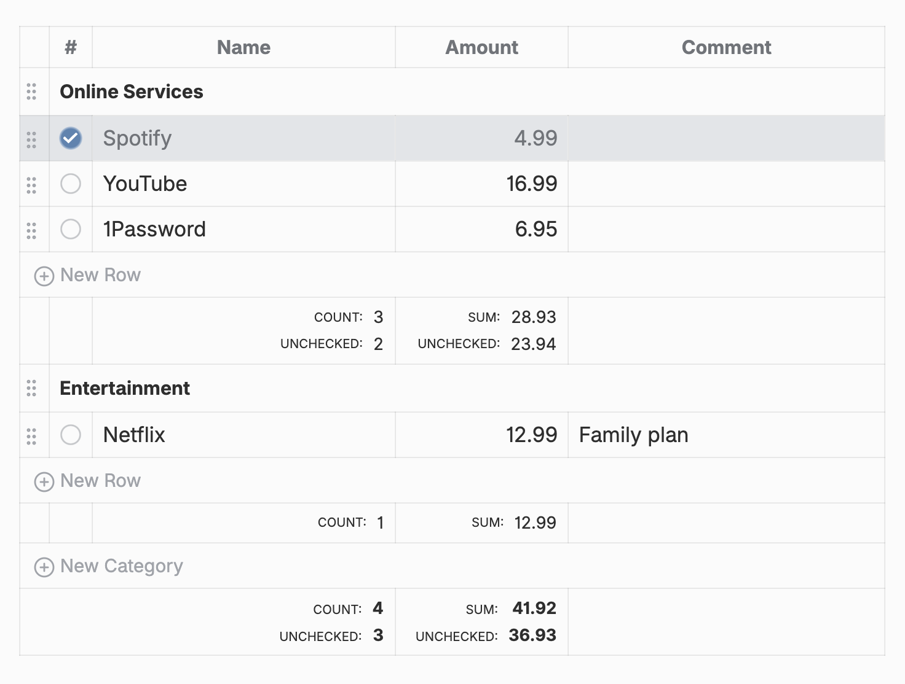

Budget Planner keeps a budget inside an Obsidian note. You write a small code block, and in the editor it becomes a table: tick what is paid, edit names and amounts in place, drag rows between categories, and the totals add up on their own.



## The note stays plain text

This is everything the table above is made of:

````md
```budget
Online Services:
	[x] | Spotify   | 4.99
	[ ] | Youtube   | 16.99
	[ ] | 1Password | 6.95
Entertainment:
	[ ] | Netflix   | 12.99  | Family plan
```
````

A line ending in `:` starts a category. A row is a checkbox, a name, an amount and an optional comment, split by `|`. Every change made in the table rewrites the block with its columns aligned, so it stays easy to read and edit by hand. The table shows in the editor; Reading view shows the plain block.

## Get started

Open **Settings → Community Plugins → Browse**, search for **Budget Planner** and install it. Then run **Budget Planner: Insert budget block** from the command palette in any note.
